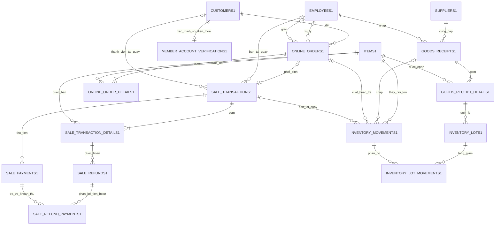

# Hệ thống quản lý siêu thị trực tuyến

Ứng dụng Java Web cho hai module **Đăng ký thành viên** và **Thống kê hàng hóa theo doanh thu**. Database PostgreSQL chứa các bảng của toàn bộ hệ thống siêu thị. Theo cách tổ chức trong giáo trình, các trang JSP nhận yêu cầu và gọi DAO trực tiếp. Các lớp `CustomerDAO1`, `ManagerDAO1` và `ItemRevenueDAO1` kế thừa `DAO1`, sử dụng JDBC `CallableStatement` để gọi các hàm lưu trữ trong `database/schema.sql`.

`DAO1` quản lý kết nối PostgreSQL dùng chung. Các thao tác DAO khóa trên `DAO1.class` và kết thúc giao dịch bằng `commit` hoặc `rollback`. Các hàm trả danh sách dùng `refcursor`, được đọc hết trong giao dịch rồi đóng. Model là lớp Java thông thường có constructor, getter và setter. DAO trả `ArrayList` hoặc đối tượng, dùng `null` khi không tìm thấy một đối tượng.

## Build và triển khai lại trên Linux

Sau khi cài JDK 21, chạy từ thư mục `supermarket`:

```bash
bash build-local.sh
cp build/supermarket.war runtime/tomcat-linux/webapps/supermarket.war
```

Lệnh `cp` áp dụng cho Tomcat đã cấu hình với `CATALINA_BASE` là
`runtime/tomcat-linux`. Tomcat với cấu hình triển khai tự động mặc định sẽ nạp
lại WAR khi file thay đổi. Nếu Tomcat đang dừng, khởi động lại bằng lệnh đã dùng
trước đó, trong terminal có các biến `SUPERMARKET_DB_URL`, `SUPERMARKET_DB_USER`
và `SUPERMARKET_DB_PASSWORD`. Mở <http://localhost:8080/supermarket/> nếu giữ
cổng mặc định của Tomcat.

Script biên dịch vào thư mục tạm mới mỗi lần build và đóng gói các file `.class`
vào `WEB-INF/classes/vn/pttk/supermarket/...`. Đây là vị trí Tomcat dùng để tìm
các lớp Java của ứng dụng. Đặt thư mục `vn` ở gốc WAR sẽ gây lỗi JSP như
`ManagerDAO1 cannot be resolved to a type` hoặc `Html1 cannot be resolved`.

## Chạy trên Windows

Nhấp đúp `Start.cmd` trong File Explorer để chạy ứng dụng và mở trang chủ trong trình duyệt.

Trong IntelliJ, tạo công cụ **Start Supermarket** tại **Settings → Tools → External Tools**. Điền **Program** là `C:\Windows\System32\cmd.exe`, **Arguments** là `/d /c call D:\pttk\supermarket\Start.cmd` và **Working directory** là `D:\pttk\supermarket`. Lệnh `call` gọi đúng file `Start.cmd` ngay cả khi thư mục đang mở trong IntelliJ là `D:\pttk`. Sau khi lưu, chọn **Tools → External Tools → Start Supermarket**.

Mở PowerShell và chạy:

```powershell
cd D:\pttk\supermarket
pwsh -NoProfile -ExecutionPolicy Bypass -File .\start-local.ps1
```

Mở **http://127.0.0.1:8088/supermarket/**. Script khởi động Tomcat 10.1 và cụm PostgreSQL dành riêng cho dự án. Cụm này nghe tại `127.0.0.1:55432`, dùng database `supermarket_pttk` và người dùng `supermarket_dev`. Mật khẩu của cụm được tạo tự động và nằm trong `runtime/postgres.password`. Script nạp dữ liệu mẫu khi tạo schema lần đầu.

Sau khi sửa mã nguồn, chạy các lệnh sau để đóng gói và triển khai lại:

```powershell
pwsh -NoProfile -ExecutionPolicy Bypass -File .\start-local.ps1 -Stop
pwsh -NoProfile -ExecutionPolicy Bypass -File .\start-local.ps1 -Build
```

Script dùng `javac` và `jar` của JDK 21 để tạo `build/supermarket.war`. Các JAR của JDBC có sẵn trong `WebContent/WEB-INF/lib`. Trên máy khác, cài JDK 21 và PostgreSQL, giải nén bản Core ZIP của Tomcat 10.1 vào `runtime`, rồi chạy script với `-Build`. Có thể truyền `-PostgresBin` và `-TomcatHome` nếu các công cụ nằm ở thư mục khác.

## Mở dự án trong Eclipse

Trong Eclipse có Web Tools Platform, chọn **File → Import → General → Existing Projects into Workspace**. Chọn thư mục `D:\pttk\supermarket` làm thư mục gốc, chọn dự án **supermarket** và bấm **Finish**. Dự án khai báo Java 21 và Dynamic Web Module 6.0. Khi cần chạy trực tiếp bằng máy chủ trong Eclipse, cấu hình Tomcat 10.1 và các biến môi trường database bên dưới.

Eclipse hiển thị package từ `src` dưới mục **Java Resources**. JSP và CSS nằm trong **WebContent**, còn driver PostgreSQL nằm trong **WebContent → WEB-INF → lib**.

Nếu triển khai WAR bằng một Tomcat khác, tạo database trên PostgreSQL của bạn. Chạy `database/schema.sql` để tạo mới hoặc nâng cấp database hiện có. Để chạy demo, nạp thêm `database/seed.sql` sau khi chạy schema. Sau đó cấu hình `SUPERMARKET_DB_URL`, `SUPERMARKET_DB_USER`, `SUPERMARKET_DB_PASSWORD` trong môi trường của Tomcat. URL mặc định là `jdbc:postgresql://127.0.0.1:5432/supermarket_pttk`.

## Sơ đồ dữ liệu

Các bảng có hậu tố `1`. Khi chạy `schema.sql` trên bản cũ, PostgreSQL đổi tên các bảng tại chỗ và giữ nguyên dữ liệu, khóa và ID.



- `customers1` lưu khách hàng và trạng thái thành viên. Khi đăng ký, email được chuyển về chữ thường và số di động Việt Nam được lưu ở dạng `0…`. Chỉ mục duy nhất áp dụng cho số điện thoại của thành viên và nhận diện các cách viết tương đương như `+84…`. Nếu database cũ đã có hai thành viên trùng số sau chuẩn hóa, cần xử lý hai hồ sơ trước khi chạy lại schema. `member_account_verifications1` giữ tối đa một yêu cầu thiết lập tài khoản cho mỗi thành viên.
- `employees1` dùng chung cho các vai trò `MANAGEMENT`, `WAREHOUSE`, `SALER` và `DELIVERY`. Trường `username` lưu tên đăng nhập và `password_hash` lưu bản băm mật khẩu của tài khoản đã thiết lập. Báo cáo kiểm tra phiên đăng nhập và vai trò `MANAGEMENT` trên mỗi yêu cầu.
- Một giao dịch bán tại quầy tham chiếu nhân viên bán hàng. Khi đơn trực tuyến chuyển sang `COMPLETED`, PostgreSQL yêu cầu đúng một giao dịch có chi tiết khớp đơn.
- PostgreSQL tính `line_total` từ số lượng và đơn giá trước giảm giá. `discount_amount` lưu giảm giá của cả dòng bán hoặc dòng đặt hàng và mặc định bằng 0 cho dữ liệu cũ. `sale_refunds1` lưu từng khoản hoàn theo dòng bán gốc.

## Xử lý đơn hàng, tồn kho và vai trò trong PostgreSQL

`database/schema.sql` tạo `inventory_movements1` để theo dõi tăng giảm tồn theo từng hàng hóa. Bản ghi `OPENING` lấy số tồn đang có lúc nâng cấp. Các chứng từ lịch sử tiếp tục dùng trong báo cáo, và số tồn đầu kỳ đã bao gồm ảnh hưởng của lịch sử trước đó. Nếu database cũ có đơn đang ở trạng thái `DISPATCHED`, cần đối chiếu tồn trước khi nâng cấp.

| Thao tác | Hàm PostgreSQL | Đơn hàng, giao dịch và tồn kho |
|---|---|---|
| Xác nhận phiếu nhập đã có chi tiết | `post_goods_receipt(receipt_id)` | Ghi `posted_at` và tăng tồn theo các dòng nhập. |
| Xuất hàng trực tuyến | `dispatch_online_order(order_id, warehouse_id, delivery_id)` | Chuyển `PENDING` sang `DISPATCHED`, gán nhân viên và giảm tồn. |
| Hoàn tất bán trực tuyến | `complete_online_order(order_id, transaction_code)` | Tạo giao dịch và sao chép chi tiết đơn, sau đó chuyển đơn sang `COMPLETED` trong cùng giao dịch SQL. Tồn đã được giảm tại bước xuất. |
| Hủy đơn | `cancel_online_order(order_id)` | Hủy đơn chờ xử lý, hoặc hủy đơn đã xuất khi hàng thực tế được trả về kho. Đơn đã xuất được cộng trả tồn theo số lượng đã xuất. |
| Bán tại quầy | `record_counter_sale(transaction_code, saler_id, sold_at, lines_json)` | Ghi giao dịch và giảm tồn trong cùng giao dịch SQL. Mỗi dòng JSON có `item_id`, `quantity`, `unit_price` và `discount_amount` tùy chọn. |
| Ghi khoản hoàn cho một dòng bán | `record_sale_refund(refund_code, sale_detail_id, refunded_at, quantity, refund_amount)` | Tổng số lượng hoàn và tổng tiền hoàn bị giới hạn theo dòng bán gốc. Gửi lại đúng dữ liệu với cùng mã hoàn trả về bản ghi cũ. Hàng trả chỉ nên được cộng lại vào tồn bán được sau khi kho tiếp nhận và kiểm tra. |

Tạo phiếu nhập và chi tiết trước khi gọi hàm xác nhận. Tạo đơn ở trạng thái `PENDING` và thêm chi tiết trước khi gọi hàm xuất. Các hàm khóa chứng từ trong lúc xử lý để lần gọi lại cùng yêu cầu trả về mã bản ghi cũ. Nếu một mặt hàng thiếu tồn, thao tác thất bại và mọi thay đổi của lần xử lý được hoàn tác. Cột tồn hiện tại phải khớp tổng biến động.

Các khóa ngoại ghép với `employees1(id, role)` yêu cầu `WAREHOUSE` cho người nhập/xuất kho, `DELIVERY` cho người giao hàng và `SALER` cho người bán tại quầy. Việc phân quyền đăng nhập trên giao diện là phần riêng. Các thao tác kho và bán hàng trên đây được gọi qua SQL, còn Java chạy hai module của đề.

Chạy `database/verify-workflows.sql` trong Query Tool trên database demo để kiểm tra các quy tắc. Script hoàn tác các bản ghi kiểm thử sau khi chạy.

## Thanh toán, hoàn tiền, lô hàng và thành viên

- **Thanh toán.** Gọi `record_sale_payment(code, sale_id, method, amount, requested_at[, external_reference])` cho mỗi khoản thu. Sau khi có kết quả, gọi `resolve_sale_payment(payment_id, status, resolved_at)` với `SUCCEEDED` hoặc `FAILED`. Mỗi giao dịch bán đã ghi có thể có nhiều khoản thu bằng `CASH`, `CARD`, `BANK_TRANSFER` hoặc `E_WALLET`. Cột `external_reference` lưu mã đối soát bên ngoài. Với đơn online trả trước, có thể lưu thời điểm thu thực tế khi đã tạo giao dịch bán. View `sale_payment_balances1` cho biết tiền đã thu, còn phải thu, đã hoàn và thực thu. Các giao dịch cũ chưa có bản ghi thanh toán hiển thị các khoản này là `NULL`.
- **Hoàn tiền.** Dùng `record_sale_refund(code, sale_detail_id, requested_at, quantity, total_amount, allocations_json)`. Mỗi phần tử JSON có `payment_id` và `amount`, ví dụ `[{"payment_id":10,"amount":4000},{"payment_id":11,"amount":6000}]` cho khoản hoàn 10.000 ₫ chia về hai khoản đã thu. Sau khi xác nhận kết quả của khoản hoàn, gọi `resolve_sale_refund(refund_id, status, resolved_at)`. Báo cáo chỉ trừ khoản hoàn thành công vào ngày xác nhận. Các khoản đang chờ giữ hạn mức, khoản thất bại giải phóng hạn mức. Dữ liệu hoàn tiền cũ vẫn dùng ngày hoàn đã lưu.
- **Lô hàng.** Bật `items1.track_lots` cho mặt hàng cần quản lý lô. Trước khi xác nhận phiếu nhập, thêm các dòng vào `inventory_lots1` với `receipt_id`, `item_id`, `lot_code`, `expires_on` và `received_quantity`. Tổng số lượng theo lô phải khớp dòng nhập. Khi xuất, hệ thống chọn lô còn hạn có hạn dùng gần nhất trước. Nếu hủy đơn đã xuất và nhận lại hàng, hệ thống trả lại đúng các lô đã xuất. Xem tồn theo lô trong `inventory_lot_balances1` và truy vết giao dịch về phiếu nhập, nhà cung cấp trong `inventory_lot_trace1`. Tồn cũ chưa có chứng từ lô vẫn được giữ trong tổng tồn và không có mã lô suy diễn. Với mặt hàng bắt buộc theo lô, chỉ tồn có lô hợp lệ được xuất.
- **Thành viên tại quầy.** Gọi `record_counter_sale` với họ tên và số điện thoại để ghi nhận thành viên theo số và liên kết giao dịch. Gọi bản bốn đối số khi khách mua vãng lai. Bản nhận `customer_id` vẫn hỗ trợ khách đã được tra cứu trước.

Các thao tác này được triển khai ở PostgreSQL. Việc gửi yêu cầu thu hoặc hoàn tiền thật cần tích hợp dịch vụ thanh toán. Các giao dịch hoàn tiền sau bán chỉ điều chỉnh doanh thu và tiền thu. Việc đưa hàng trả về tồn bán được thuộc bước kiểm tra hàng của kho.

## Thiết kế dữ liệu đặt hàng trực tuyến

`place_online_order1` trong PostgreSQL tạo đơn chờ xử lý và gắn với hồ sơ thành viên theo số điện thoại giao hàng. Nếu số chưa có hồ sơ thành viên, hàm tạo hồ sơ cùng giao dịch lưu đơn. Hồ sơ tạo theo số điện thoại có thể để trống email và mật khẩu. Giao diện web của dự án triển khai hai module bên dưới.

## Thiết lập tài khoản cho thành viên đã có số điện thoại

1. Khi tích hợp SMS, dịch vụ tạo mã ngẫu nhiên và ID yêu cầu mới. Dịch vụ gọi `begin_member_account_setup1` với số điện thoại, ID và HMAC-SHA-256 của mã và ID yêu cầu. Khóa HMAC được giữ tại dịch vụ. Sau khi giao dịch SQL trả về `ISSUED` và được xác nhận, dịch vụ gửi mã đến số đã chuẩn hóa. Hàm áp dụng cho hồ sơ thành viên chưa có mật khẩu.
2. Khi khách nhập mã, dịch vụ tính lại HMAC và gọi `verify_member_account_phone1`. Mã có hiệu lực 5 phút và bị khóa sau 5 lần nhập sai. Lần cấp mới thay thế yêu cầu trước, cách lần gần nhất ít nhất 1 phút và tối đa 5 lần trong một cửa sổ 1 giờ tính từ lần cấp đầu. Dịch vụ xác nhận giao dịch SQL cả khi nhận `INCORRECT_CODE` để lưu số lần nhập sai.
3. Khi nhận `VERIFIED`, dịch vụ cấp cho khách một token ngẫu nhiên dùng một lần, có hiệu lực 10 phút. Dịch vụ tạo token có ít nhất 32 byte ngẫu nhiên và chỉ truyền bản băm SHA-256 vào cơ sở dữ liệu. Sau khi khách nhập email và mật khẩu, dịch vụ gọi `complete_member_account_setup1` với ID yêu cầu, bản băm token, email và bản băm mật khẩu PBKDF2 cùng định dạng với `PasswordHash1`. Nếu email trùng, khách có thể chọn email khác trong thời gian token còn hiệu lực.
4. Khi nhận `COMPLETED`, email, bản băm mật khẩu và thời điểm hoàn tất được lưu trên đúng dòng `customers1` hiện có. Mã khách hàng và các đơn, giao dịch đã gắn với mã đó được giữ nguyên. Yêu cầu xác minh bị xóa. Dịch vụ đăng nhập khách hàng sau này có thể dùng `find_member_account1` để tra cứu theo email chuẩn hóa và kiểm tra mật khẩu ở máy chủ.

PostgreSQL lưu bản kiểm tra mã SMS và bản băm token. Chỉ cấp quyền gọi các hàm phù hợp cho dịch vụ phía máy chủ và dùng phản hồi chung khi yêu cầu gửi mã để hạn chế việc dò số thành viên. Gửi SMS, đăng nhập khách hàng và khôi phục mật khẩu là các phần tích hợp ngoài hai module Java Web hiện tại. Biểu mẫu đăng ký thành viên đang dùng tiếp tục báo trùng khi khách nhập số đã có hồ sơ.

## Chạy thử hai module


1. Chọn **Đăng ký thành viên**, nhập dữ liệu thử với email và số điện thoại mới, rồi nhấn **Thêm**. Kiểm tra thông báo thành công và bản ghi mới trong `customers1`. Thử email khác với cùng số ở dạng `+84…` để kiểm tra thông báo trùng ngay dưới trường số điện thoại.
2. Chọn **Báo cáo thống kê** và đăng nhập bằng tên `quanly` hoặc mã nhân viên `QL01`. Script khởi động cục bộ tạo mật khẩu demo ở `runtime/manager.password` khi thiết lập tài khoản lần đầu. Sau đó chọn **Thống kê hàng hóa theo doanh thu**, đặt ngày từ **01/11/2026** đến **03/11/2026** hoặc nhấn liên kết xem mẫu. Kết quả gồm:
   - `HH002` Gạo thơm 5 kg: 3 túi, **425.000 ₫**.
   - `HH001` Sữa tươi 1 lít: 4 hộp, **148.000 ₫**.
   - `HH003` Nước cam 350 ml: 2 chai, **30.000 ₫**.
3. Chọn `HH001` để xem `GD101`, `GD102` và `GD103`. Ở `GD101`, thành tiền riêng của sữa là **72.000 ₫**, còn tổng giao dịch là **217.000 ₫**. Giao dịch trước 01/11 và từ đầu 04/11 nằm ngoài khoảng chọn.
4. Chọn mẫu **05–07/11/2026** để đối chiếu `GD105-MAU` và `HT105-MAU`. Tiền hàng **100.000 ₫**, giảm **10.000 ₫**, hoàn **45.000 ₫** cho 1 trong 2 hộp đã bán. Tổng của cả kỳ là **45.000 ₫**. Chọn riêng ngày 07/11 để xem doanh thu **−45.000 ₫**. Nếu database demo đã được tạo từ bản cũ, chạy lại `database/seed.sql` sau khi nâng cấp schema để nạp hai chứng từ mẫu.

## Đối chiếu với báo cáo

| Module | Luồng JSP | DAO và bảng sử dụng |
|---|---|---|
| Đăng ký thành viên | `gdMemberRegistration1.jsp` gửi biểu mẫu tới `doMemberRegistration1.jsp` | JSP gọi `CustomerDAO1.register`. DAO gọi hàm `register_member1` để ghi `customers1`. |
| Thống kê hàng hóa | `gdStatisticsMenu1.jsp` → `gdItemStatistics1.jsp` → `gdItemDetails1.jsp` | `ItemRevenueDAO1` gọi `get_item_revenue1`, `find_item1` và `get_related_transactions1`. Các hàm đọc `items1`, `item_revenue_events1` và lịch sử nhập từ nhà cung cấp. |

Mã Java nằm trong `src`, chia thành các package `model` (dữ liệu), `dao` (truy cập PostgreSQL) và `web` (tiện ích JSP). Các trang JSP được chia theo nhóm người dùng trong `WebContent/WEB-INF/views`.

- `customer` chứa trang đăng ký thành viên và trang xử lý lưu.
- `manager` chứa menu báo cáo, trang thống kê, trang chi tiết giao dịch và các đoạn xử lý bộ lọc dùng chung trong báo cáo.
- `common` chứa phần đầu và chân trang dùng chung.

`WEB-INF/web.xml` ánh xạ URL trực tiếp đến từng trang JSP trong nhóm tương ứng.

Schema lưu thời điểm giao dịch theo giờ địa phương Việt Nam. Báo cáo lấy các sự kiện từ đầu ngày bắt đầu đến trước đầu ngày sau ngày kết thúc. Tiền hàng và giảm giá được tính vào ngày bán. Tiền hoàn được trừ vào ngày hoàn, kể cả khi ngày bán nằm ngoài kỳ. Doanh thu trong kỳ bằng tiền hàng trừ giảm giá và tiền hoàn.

Nhà cung cấp được xác định từ phiếu nhập đã xác nhận đến hết ngày kết thúc. Một mặt hàng có thể hiển thị nhiều nhà cung cấp. Tổng doanh thu cộng doanh thu của các mặt hàng trong kỳ, tách biệt với truy vấn thông tin nhà cung cấp.
